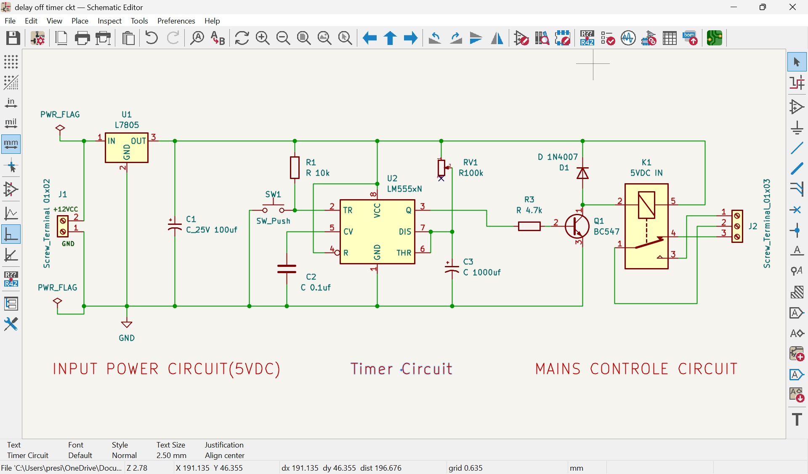
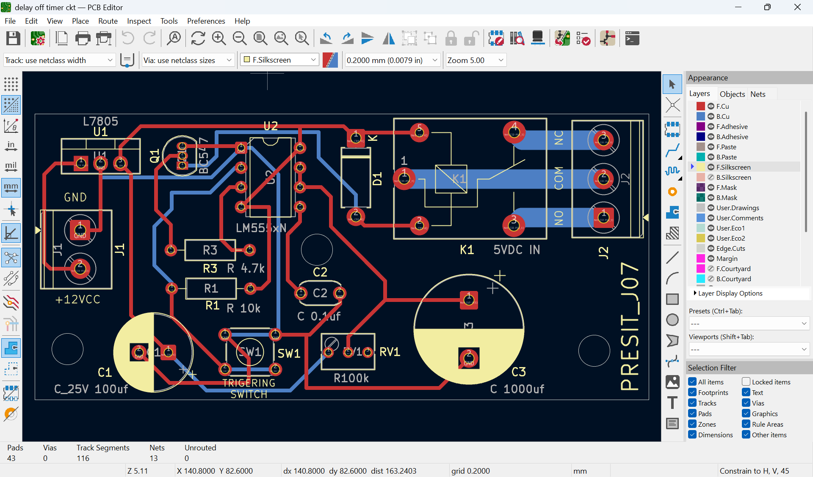
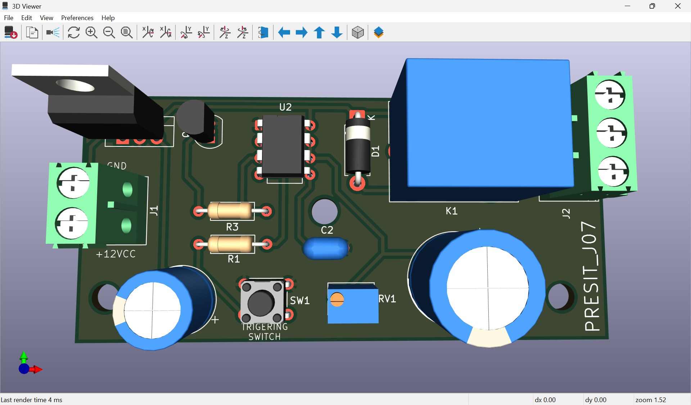
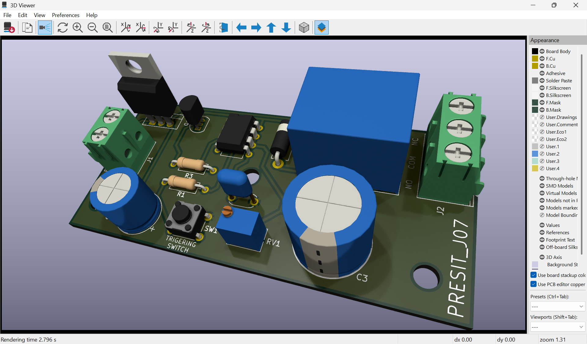

# 555 Timer Delay-Off Timer

A practical electronics learning project exploring **delay-off timer operation, relay control, and PCB design** using a 555 timer IC and KiCad.

This project is part of my learning journey as an Electrical Engineering student. The goal is to understand how a timer circuit works, how its components determine the delay, and how a circuit moves from a schematic to a PCB layout.

> **Important:** Confirm the exact timing behavior and formula against the final schematic and practical test. The operation depends on how the 555 timer, trigger, RC network, and relay interface are connected.

## 1. Project Objectives

- Understand the 555 timer IC and its timing function.
- Learn how resistor-capacitor (RC) networks create a time delay.
- Study push-button triggering and relay switching.
- Design and document a circuit in KiCad.
- Explore schematic capture, PCB layout, and 3D board visualization.
- Prepare a Bill of Materials (BOM) and PCB manufacturing outputs.
- Practice testing, troubleshooting, and documenting an electronics project.

## 2. What Is a Delay-Off Timer?

A delay-off timer keeps a load operating for a defined period and then switches it OFF. Depending on the design, the delay may begin when a trigger is applied or when a control signal is removed.

In a relay-based circuit, relay contacts can switch a separate load. The relay's input polarity and the timer's output interface determine how the load behaves during the timing interval.

Confirm the exact sequence for this circuit against the schematic and practical test: what happens at power-up, when the button is pressed, and when the delay expires.

## 3. Working Principle of the 555 Timer

The 555 timer contains internal comparators, a latch, and a discharge transistor. These monitor the timing capacitor voltage and control the output state.

In a common monostable configuration:
1. A trigger pulse changes the output state.
2. The timing capacitor charges through a resistor.
3. The 555 monitors the capacitor voltage against an internal threshold.
4. When the threshold is reached, the output returns to its original state and the capacitor is discharged.

The external circuit configuration determines whether this sequence matches the intended delay-off behavior.

## 4. RC Timing Concept

A resistor-capacitor (RC) network sets the time required for the capacitor voltage to change.

For a conventional 555 monostable circuit, the approximate pulse duration is:

**T ≈ 1.1 × R × C**

Where:
- **T** is the timing interval in seconds.
- **R** is the effective timing resistance in ohms.
- **C** is the timing capacitance in farads.

This formula applies only to the corresponding monostable topology. Other 555 configurations can use different timing relationships. Actual timing varies with component tolerances, capacitor leakage, supply voltage, temperature, and circuit implementation.

## 5. Circuit Features

- 555 timer-based timing control
- Push-button trigger, as shown in the schematic
- Relay-based switching interface
- Adjustable timing only if an adjustment component is present in the final design
- KiCad schematic and PCB layout
- 3D PCB visualization
- BOM and Gerber manufacturing files

## 6. Main Components

Refer to the actual schematic and `BOM.csv` for confirmed values, quantities, footprints, and part numbers.

| Component | Purpose |
|---|---|
| 555 timer IC | Generates the timing response |
| Timing resistor(s) | Control capacitor charging or discharging rate |
| Timing capacitor | Stores charge and establishes the interval |
| Push button / trigger input | Initiates the timing sequence, according to the circuit |
| Relay or relay module | Switches the external load |
| Power supply and connectors | Provide power and circuit connections |
| PCB and footprints | Provide the physical circuit layout |

Verify all component values against the final schematic before assembly.

## 7. Design Files and Previews

### Circuit schematic


[Open the schematic PDF](schematic.pdf)

### PCB layout


### 3D PCB views




Update image paths if your repository uses different folders or filenames.

## 8. Repository Structure

This is a suggested structure. Keep the paths consistent with the files uploaded to GitHub.

```text
555-Timer-Delay-Off-Circuit/
├── README.md
├── schematic.pdf
├── BOM.csv
├── Gerber.zip
├── KiCad/
│   ├── delay off timer ckt.kicad_pro
│   ├── delay off timer ckt.kicad_sch
│   └── delay off timer ckt.kicad_pcb
└── Images/
    ├── schematic.png
    ├── pcb-layout.png
    ├── 1_pcb-3d.png
    └── 2_pcb-3d.png
```

- `.kicad_pro` — KiCad project settings
- `.kicad_sch` — editable schematic
- `.kicad_pcb` — editable PCB layout
- `schematic.pdf` — printable schematic
- `BOM.csv` — component list
- `Gerber.zip` — manufacturing outputs, if it contains exported Gerber and drill files

## 9. Software and Tools

- **KiCad EDA** — schematic capture, PCB layout, and 3D board inspection
- **555 timer IC** — timing and control
- **RC timing network** — sets the capacitor voltage transition
- **Relay interface** — switches a load within its ratings

## 10. How to Open the Design

1. Download or clone the repository.
2. Open the `.kicad_pro` file in KiCad.
3. Open the schematic to study connections and component values.
4. Open the PCB layout to inspect footprints, routing, board outline, and silkscreen.
5. Open the 3D Viewer to inspect the board representation.
6. Include any custom symbols, footprints, or 3D models needed by the design.

## 11. Testing and Validation

- [ ] Schematic reviewed
- [ ] KiCad Electrical Rules Checker (ERC) results reviewed
- [ ] KiCad PCB Design Rules Checker (DRC) results reviewed
- [ ] Footprints and connector pinouts verified
- [ ] Supply voltage and component ratings verified
- [ ] Relay input polarity and startup state tested
- [ ] Button-trigger sequence tested
- [ ] Actual delay measured and recorded
- [ ] Relay switches at the intended point in the sequence
- [ ] 3D view checked against component placement

A useful experiment is to measure the delay several times, calculate the average, and compare it with the theoretical value from the correct circuit equation. Record differences and consider component tolerances and circuit topology.

## 12. Applications

- Timed relay control
- Automatic switching
- Small automation experiments
- Educational electronics laboratories
- Control of suitable low-voltage loads

Application suitability depends on the circuit ratings and tested behavior.

## 13. Safety Notes

- Start with a suitable low-voltage, current-limited supply.
- Use a safe low-voltage load during initial tests.
- Check relay module supply requirements and contact ratings.
- Never exceed component voltage or current ratings.
- For mains switching, use suitable isolation, enclosure, fusing, clearances, and qualified supervision. Never touch exposed mains wiring while powered.

## 14. Learning Outcomes

Through this project, I am learning to:
- Connect circuit theory with practical electronics.
- Understand 555 timer operation and RC timing.
- Read and create electronic schematics.
- Design a PCB and inspect it in 3D.
- Prepare technical documentation and manufacturing files.
- Test circuit behavior and troubleshoot differences between theory and practice.

## License

This project's hardware design files, including the KiCad schematic and PCB layout, are licensed under the **CERN Open Hardware Licence Version 2 – Strongly Reciprocal (CERN-OHL-S-2.0)**.

You may use, study, modify, and redistribute the covered design files under the terms of this license. Modified versions of the covered hardware design must comply with its applicable reciprocal-sharing requirements.

See the [full CERN-OHL-S-2.0 license](https://ohwr.org/cern_ohl_s_v2.txt) for details.
 
---

**Project type:** Electrical Engineering · PCB Design · Analog Electronics · Timer Circuits · PCB Design  
**Design tool:** KiCad  
**Purpose:** Learning, experimentation, and documentation
